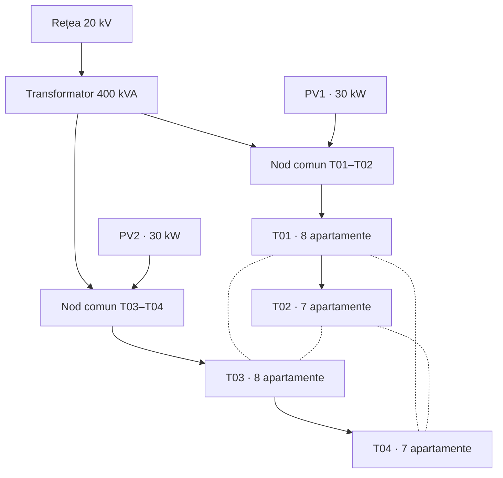
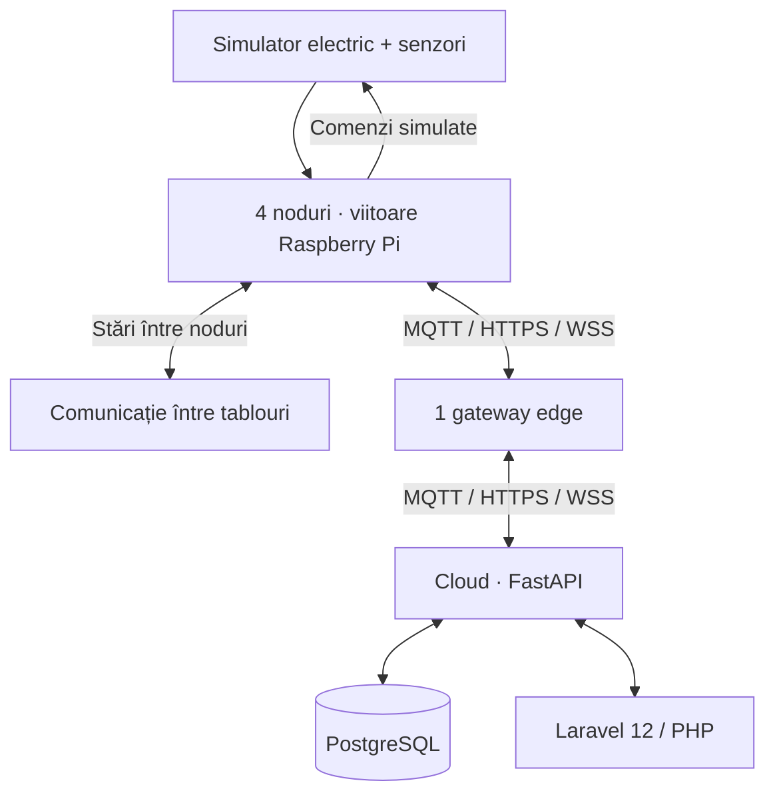

# Electrical Distribution IoT

**Platformă IoT pentru monitorizarea și automatizarea unei rețele electrice de distribuție simulate.**

Proiectul integrează senzori software, noduri de tablou, un gateway edge și o interfață web. Obiectivele principale sunt **detectarea anomaliilor**, **reconectarea adaptivă** și **sprijinul între tablouri la suprasarcină**, cu reducerea controlată a consumului flexibil când sprijinul este insuficient.

> **Stadiu:** proiectare. Sistemul va fi inițial integral simulat; rezultatele experimentale și instrucțiunile de rulare vor fi adăugate după implementare.

## Modelul rețelei

Simulăm un cartier cu **30 de apartamente de două camere**, distribuite între patru tablouri. Parametrii electrici sunt ipoteze de simulare, care vor fi verificați prin calcul. T01–T04 sunt tablouri, nu transformatoare. Fiecare poate primi sprijin de la oricare dintre celelalte trei. Alimentarea inițială este radială; legăturile suplimentare, normal deschise, permit configurații temporar buclate.

| Element | Configurație |
| --- | --- |
| Alimentare | 1 sursă echivalentă de 20 kV și 1 transformator 20/0,4 kV, 400 kVA |
| Tablouri și consumatori | T01: 8; T02: 7; T03: 8; T04: 7 apartamente |
| Producători locali | PV1: 30 kW pentru T01–T02; PV2: 30 kW pentru T03–T04; fiecare racordată o singură dată la nodul comun al grupului |
| Interconectare | 6 legături între toate perechile de tablouri; fiecare tablou poate sprijini oricare dintre celelalte trei |
| Noduri informatice | 4 noduri de tablou, 1 gateway edge comun și 1 centru de control |
| Simulare | 24 h simulate, pas de 1 s; gestionarea bateriilor rămâne o extensie ulterioară |

Profilurile casnice sintetice variază zi/noapte și între apartamente, cu **150–250 kWh/lună** de referință, pentru o lună de 30 de zile. Fiecare locuință are consum esențial și consum flexibil comandabil, o ipoteză explicită a simulatorului. Puterile se agregă per tablou pentru calculul electric; reducerea consumului flexibil modifică energia efectiv servită.

Liniile punctate reprezintă legăturile suplimentare de sprijin, normal deschise. Sprijinul este posibil în ambele sensuri, în limitele electrice verificate prin simulare.

## Obiective

- **Monitorizarea rețelei electrice** – colectarea și vizualizarea consumului, producției fotovoltaice, parametrilor electrici și stărilor echipamentelor.
- **Detectarea anomaliilor** – identificarea locală a valorilor eronate, suprasarcinilor și problemelor de funcționare.
- **Reconectarea adaptivă** – menținerea comunicației prin selectarea automată între MQTT, HTTPS și WSS.
- **Gestionarea suprasarcinilor** – redistribuirea sarcinii prin sprijin între tablouri și reducerea consumului flexibil atunci când este necesar.
- **Automatizarea și controlul rețelei** – aplicarea comenzilor automate sau manuale, cu verificarea limitelor electrice.
- **Evaluarea performanței** – compararea soluțiilor de detecție, comunicație și gestionare a suprasarcinilor în scenarii simulate.

## Arhitectură și funcționalități

**Tablourile primesc alimentarea și distribuie energia către circuitele locuințelor**, integrând protecția, comanda și măsurarea. Nodul fiecărui tablou citește senzorii și stările echipamentelor, numără acționările confirmate și transmite datele către edge. Ulterior, nodurile pot rula pe Raspberry Pi cu senzori reali; gateway-ul edge rămâne separat.

- **Simulatorul** generează consumul și producția, calculează regimul electric cu `pandapower` și injectează anomalii.
- **Edge-ul** validează formatul, unitățile, timpul și plauzibilitatea; păstrează datele brute și corecțiile. Valorile critice reale sunt semnalate, nu normalizate artificial. Detecția continuă când cloud-ul este inaccesibil.
- **Centrul și dashboard-ul** stochează istoricul și afișează consumul, producția, alertele, stările aparatelor și protocoalele active. Datele învechite sunt marcate.

| Echipament digital simulat | Măsurători / stări |
| --- | --- |
| Analizor PowerLogic PM3255 | Tensiune, curent, putere, energie, frecvență și factor de putere |
| TH110 și CL110 | Temperaturile conexiunilor, temperatura și umiditatea dulapului |
| Monitorizarea ușii și a echipamentelor | Ușă deschisă/închisă, stări, declanșări și număr de acționări confirmate |
| Termostat și monitorizarea încălzitorului | Cerere de încălzire, cuplare și consum; temperatura prin senzorul ambiental sau termostat compatibil |

### Reconectare adaptivă

Nodurile și edge-ul selectează automat dintre **MQTT, HTTPS și WSS** un serviciu compatibil și accesibil, pe baza latenței, eșecurilor și traficului. Pragurile de stabilitate evită comutările repetate; mesajele neconfirmate sunt memorate, retransmise și deduplicate. Același principiu se aplică schimbului de mesaje între tablouri. Este necesară cel puțin o cale de comunicație funcțională.

### Sprijin la suprasarcină și control manual

La depășirea persistentă a pragului de încărcare, edge-ul evaluează celelalte trei tablouri și selectează sprijinul disponibil pentru **excesul de sarcină**, fără împărțire obligatorie 50/50. Repartizarea rezultă din calculul electric; sunt verificate tensiunile și limitele ramurilor și transformatorului comun. Dacă sprijinul este insuficient, se reduce consumul flexibil; o depășire rămasă nerezolvată generează alertă.

Operatorul poate comanda din dashboard, cu prioritate temporară față de automatizare, în limitele electrice modelate. Când configurația inițială redevine fezabilă și stabilă, sistemul revine automat și încheie intervenția manuală. Comutarea este declanșată de încărcare, nu de programări orare. Comenzile sunt identificate și confirmate; termostatul comandă local încălzitorul.

## Tehnologii

| Componentă | Tehnologii |
| --- | --- |
| Simulare, noduri și edge | Python, `asyncio`, `pandapower` |
| Comunicații și backend | MQTT, HTTPS, WSS, FastAPI |
| Dashboard și persistență | Laravel 12, PHP, Blade, JavaScript, PostgreSQL |

## Evaluare experimentală

**RQ:** În ce condiții detecția la edge reduce latența și traficul față de cloud? **Ipoteză:** procesarea locală îmbunătățește acest compromis când comunicația este degradată.

| Comparație | Indicatori |
| --- | --- |
| Aceeași detecție la edge vs. cloud | Latența detecției și trafic către centru |
| Protocol fix vs. selecție adaptivă | Reconectare, rată de livrare, duplicate și comutări |
| Reducere locală fără sprijin vs. sprijin urmat de reducere | Durata suprasarcinii, energie flexibilă neservită, încălcări de limite și comutări |

Se folosesc aceleași profiluri, seed-uri și anomalii: suprasarcină, încălzire, frig, erori de senzori și căderi de comunicație. Se verifică sprijinul disponibil/insuficient, prioritatea manuală, revenirea automată, confirmarea comenzilor și funcționarea fără cloud. Nu sunt raportate încă rezultate validate. Experimentele sunt integral simulate, pe un model trifazat echilibrat, și nu validează comutații pe instalații fizice.

## Referințe științifice

Bibliografie pentru fundamentarea arhitecturii, profilurilor și experimentelor; parametrii scenariului sunt alegeri ale proiectului.

1. Güngör et al. (2011). [Smart Grid Technologies: Communication Technologies and Standards](https://doi.org/10.1109/TII.2011.2166794). *IEEE Transactions on Industrial Informatics*.
2. Shi et al. (2016). [Edge Computing: Vision and Challenges](https://doi.org/10.1109/JIOT.2016.2579198). *IEEE Internet of Things Journal*.
3. Bonomi et al. (2012). [Fog Computing and Its Role in the Internet of Things](https://doi.org/10.1145/2342509.2342513). *ACM MCC Workshop*.
4. Dizdarević et al. (2019). [A Survey of Communication Protocols for Internet of Things and Related Challenges of Fog and Cloud Computing Integration](https://doi.org/10.1145/3292674). *ACM Computing Surveys*.
5. Richardson et al. (2010). [Domestic Electricity Use: A High-Resolution Energy Demand Model](https://doi.org/10.1016/j.enbuild.2010.05.023). *Energy and Buildings*.
6. Pipattanasomporn et al. (2014). [Load Profiles of Selected Major Household Appliances and Their Demand Response Opportunities](https://doi.org/10.1109/TSG.2013.2268664). *IEEE Transactions on Smart Grid*.
7. Thurner et al. (2018). [pandapower—An Open-Source Python Tool for Convenient Modeling, Analysis, and Optimization of Electric Power Systems](https://doi.org/10.1109/TPWRS.2018.2829021). *IEEE Transactions on Power Systems*.

## Autori

Studenții **Hosu Răzvan** și **Nistor Dorin**.
