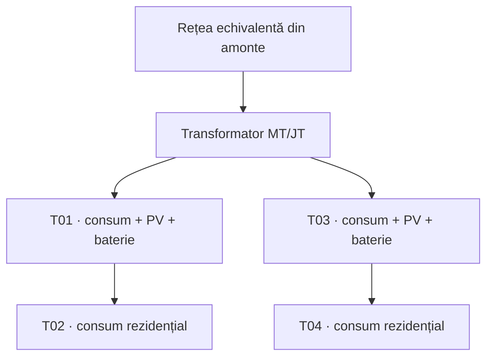
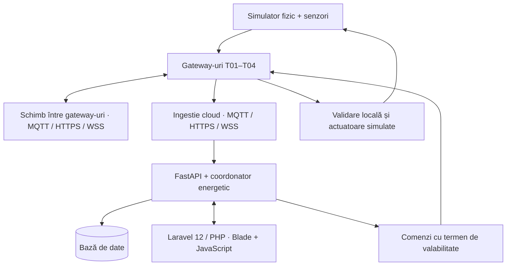

# Electrical Distribution IoT

### Monitorizarea și coordonarea energetică a tablourilor de distribuție dintr-un sector urban

**Autori:** Hosu Răzvan și Nistor Dorin  
**Nume propus pentru repository:** `electrical-distribution-iot`  
**Repository:** [URL de completat după creare]  
**Scenariu:** Smart Energy / distribuție electrică urbană cu stocare distribuită  
**Documentare:** 11 octombrie 2026

> Proiectul simulează un sector urban cu patru tablouri electrice, consumatori, producție fotovoltaică și baterii. Senzorii software transmit măsurători către gateway-uri edge, care verifică datele și detectează anomalii. Un backend central păstrează istoricul și coordonează resursele energetice, iar o aplicație web în Laravel 12 și PHP afișează starea rețelei și efectele deciziilor. Gateway-urile aleg automat un protocol alternativ disponibil, atât către centru, cât și între tablouri. Componenta de cercetare evaluează separat procesarea edge, reconectarea adaptivă și coordonarea energetică.

## 1. Contextul și delimitarea temei

Într-un sector urban, consumul diferă între zone și se modifică în timp. Unele ramuri pot fi intens solicitate, în timp ce în alte zone există producție locală sau energie disponibilă în baterii. O aplicație IoT poate observa aceste diferențe, identifica măsurători incorecte și propune utilizarea coordonată a resurselor.

Tema se încadrează în monitorizarea rețelelor de distribuție cu resurse energetice distribuite, numite DER. Producția locală și stocarea sunt compatibile cu acest cadru [3]. În MVP, sectorul rămâne conectat la rețeaua publică; funcționarea autonomă de tip microgrid nu este demonstrată.

### Clarificări ale modelului electric

- **Tabloul distribuie energia; nu o produce.** Producția aparține surselor conectate, iar bateria este o resursă asociată nodului, conectată printr-un convertor.
- Centralele nucleare, hidrocentralele și parcurile eoliene sunt reprezentate agregat prin rețeaua din amonte. Nu simulăm câte o centrală pentru fiecare tablou și nici mixul energetic național.
- Termenii folosiți sunt **redistribuirea puterii**, **gestionarea energiei stocate** și **reducerea solicitării ramurilor**. „Redistribuirea potențialilor” nu descrie obiectivul proiectului.
- Puterea instantanee se exprimă în **kW**, energia în **kWh**, tensiunea în **V**, iar curentul în **A**.
- Consumuri diferite între tablouri nu reprezintă automat o anomalie. Urmărim limitele echipamentelor și necesarul fiecărei zone; nu forțăm consumuri egale.
- Energia nu este rutată ca un pachet IP. Într-o rețea AC, fluxurile rezultă din topologie, impedanțe și injecțiile/consumurile nodurilor. Alegerea unui donator apropiat este o politică de coordonare, nu o comandă care obligă electronii să urmeze o rută.
- Drumul cel mai scurt geometric nu garantează pierderile minime. Rezistența, curentul și starea celorlalte ramuri contează. Pentru un conductor, pierderea Joule este aproximativ `I²R`; pentru trei faze echilibrate, `3I²R`, cu `R` pe fază.

**Interpretarea ideii de „redistribuire egală”:** sprijinirea zonelor cu deficit și, când rămâne surplus, încărcarea bateriilor eligibile ținând cont de capacitatea lor și de SoC. Egalitatea strictă a puterilor transferate nu este un obiectiv prioritar.

## 2. Cerințele de referință și obiectivele proiectului

Documentul profesorului cere o propunere orientată către cercetare, cu întrebare, ipoteză, baseline, experiment și limite ale concluziilor [1]. Exemplul cu sera oferă un model de prezentare pentru fluxul IoT [2].

| Element din structura profesorului | Acoperire în acest README |
|---|---|
| Titlu, echipă, scenariu | Introducere și secțiunile 1–3 |
| Arhitectură | Secțiunea 4 |
| Întrebare de cercetare și ipoteză | Secțiunea 9 |
| Baseline și abordare propusă | Secțiunile 7 și 9 |
| Date, scenarii, variabile, metrici | Secțiunile 5 și 10 |
| Tehnologii și reproducere | Secțiunile 12–13 |
| Rezultate și limitări | Secțiunile 14 și 16 |

### MVP IoT

- [ ] Patru tablouri simulate, fiecare cu măsurări electrice și temperatură.
- [ ] Generare periodică, reproductibilă și injectare de anomalii etichetate.
- [ ] Gateway pentru fiecare tablou: validare, corecții documentate, calitatea datelor și alerte.
- [ ] Transmitere către backend, stocare și API de consultare.
- [ ] Dashboard Laravel 12/PHP cu valori, grafice, stare de conectare și istoric de alerte.
- [ ] Schimb de rezumate între gateway-uri și comunicare cu centrul de control.
- [ ] Adaptoare MQTT, HTTPS și WSS și selecție automată după disponibilitate și scor.
- [ ] Buffer persistent, confirmări și deduplicare între protocoale.
- [ ] Experimente edge versus cloud și protocol fix versus selecție adaptivă.

### Funcționalitatea specifică temei

- [ ] Model electric cu patru noduri de distribuție și două baterii.
- [ ] Calcul al fluxurilor pentru verificarea tensiunilor, încărcărilor și pierderilor.
- [ ] Coordonarea puterilor bateriilor și limitarea producției locale când este necesar.
- [ ] Compararea unei politici bazate pe proximitate cu o politică ce verifică efectele în întreaga rețea.

### Extensii după validarea MVP-ului

- Detector statistic sau ML, comparat cu regulile inițiale.
- Asistent LLM care explică istoricul pe baza datelor aplicației.
- Reconfigurare simulată a topologiei, cu validarea fiecărei configurații.

ML, LLM și reconfigurarea topologiei rămân extensii. **Comunicația multiprotocol cu reconectare adaptivă face parte din obiectivele de bază ale proiectului**, conform cerințelor stabilite de echipă. Documentul profesorului [1] fundamentează structura cercetării, fără a fi prezentat drept sursă pentru aceste alegeri concrete de implementare.

## 3. Scenariul fizic simulat

Modelul de bază conține o sursă echivalentă din amonte, un transformator și patru tablouri de joasă tensiune. Rețeaua este radială și fixă în prima versiune.



Săgețile arată structura alimentării, nu interzic fluxurile inverse. Exportul dintr-un nod cu PV poate inversa sensul curentului pe anumite ramuri.

| Element | Configurație inițială propusă |
|---|---|
| Tablouri | T01, T02, T03, T04 |
| Rețea JT | 0,4 kV între faze; model trifazat echilibrat |
| Transformator | 20/0,4 kV, 400 kVA; parametru demonstrativ |
| Consum agregat/tablou | Profil de 10–60 kW în scenariul normal |
| Producție locală | PV de maximum 80 kW la T01 și T03 |
| Baterii | Câte 100 kWh la T01 și T03; maximum 30 kW la încărcare/descărcare |
| SoC operațional | 20–90%; SoC inițial 60%, exceptând scenariile dedicate |
| Randament baterie | 95% încărcare și 95% descărcare, ipoteze de simulare |
| Linii | Lungimi, rezistențe, reactanțe și curenți admisibili declarați în configurație |

Valorile sunt ipoteze de laborator, nu dimensionări pentru o instalație reală. Înainte de experimente se fixează parametrii liniilor și se verifică faptul că scenariul normal are o soluție fezabilă. Parametrii nu se modifică ulterior pentru a favoriza un algoritm.

Sistemul controlează doar resursele explicit modelate: puterea bateriilor și, dacă este necesar, limitarea PV. Nu poate „muta” arbitrar consumatorii de pe un tablou pe altul. Dacă lipsesc resursele pentru eliminarea unei suprasarcini, raportează situația nerezolvată.

## 4. Arhitectura IoT



**Planul de date** transportă măsurători și alerte. **Planul de control** transportă comenzi de putere și confirmări. Rețeaua de comunicații este distinctă de schema electrică: vecinătatea MQTT nu înseamnă conectare printr-un cablu de energie.

| Componentă | Responsabilitate |
|---|---|
| Simulator | Calculează starea fizică, generează măsurători zgomotoase și aplică acțiunile simulate |
| Edge/Gateway | Verifică schema și valorile, păstrează date brute, generează alerte locale, transmite și memorează temporar |
| Manager multiprotocol | Selectează canalul pentru fiecare destinație, verifică disponibilitatea și gestionează reconectarea |
| Broker local | Distribuie stări pe canalul MQTT; adaptoarele HTTPS/WSS oferă alternative compatibile |
| Backend | Stochează, expune API-uri, urmărește alertele și calculează propuneri de coordonare |
| Coordonator | Emite un singur plan de control pentru toate resursele, evitând alocarea dublă |
| Aplicație web Laravel | Consumă API-ul FastAPI și prezintă măsurători, protocoale active, alerte și decizii |

În MVP, comunicarea între tablouri înseamnă publicarea și consumarea unor rezumate locale: stare, SoC, putere disponibilă, alerte și vechimea datelor. Negocierea distribuită autonomă este o extensie; autoritatea asupra comenzilor globale aparține centrului de control.

La pierderea legăturii cu cloud-ul, gateway-urile funcționale verifică protocoalele alternative și continuă monitorizarea locală și memorarea datelor. După expirarea comenzilor, bateriile revin la setpoint-ul conservator definit pentru simulare, inițial `0 kW`. Nu inițiază transferuri globale folosind informații învechite.

## 5. Senzorii, datele și simulatorul

### Măsurători și frecvențe

| Mărime | Unitate | Sursă simulată | Utilizare |
|---|---|---|---|
| Tensiune între faze | V | Model de rețea + zgomot de măsurare | Abateri de tensiune |
| Curent pe fază | A | Fluxul prin alimentarea tabloului | Solicitarea circuitului |
| Putere consumată | kW | Profilul agregat al consumatorilor | Necesar energetic |
| Putere PV | kW | Profil de producție | Surplus local |
| Temperatură în dulap | °C | Model termic simplificat | Supraîncălzire |
| SoC baterie | % | Integrarea energiei în timp | Disponibilitatea stocării |
| Stare conexiune/dispozitiv | stare | Heartbeat și ultima măsurare | Detectarea indisponibilității |

Pasul fizic și perioada de eșantionare sunt inițial `5 s`; rezumatul pentru cloud se transmite la `15 s`, iar evenimentele se trimit imediat. Pentru scenarii energetice lungi se poate accelera timpul simulat, fără a folosi acele rulări pentru măsurarea latenței reale.

Puterea, tensiunea și curentul nu sunt generate independent. Pentru verificări orientative într-un regim echilibrat: `P ≈ √3 × U_LL × I × cosφ`. În calcul se folosesc mărimi de la același punct de măsură și aceeași convenție de semn; curentul unei ramuri cu noduri în aval nu se confundă cu simplul consum local.

### Generarea datelor

1. Se construiește profilul de consum și de producție pentru fiecare nod.
2. Se aplică puterile comandate și se rezolvă fluxul de putere.
3. Se salvează starea adevărată a simulării, separat de telemetrie.
4. Peste măsurători se adaugă zgomot, offset sau defecte controlate.
5. Datele ajung la gateway; etichetele anomaliilor rămân exclusiv în evaluator.

Un `seed` și fișierele de configurare fac generarea reproductibilă. Nu este necesar un dataset extern pentru MVP. Dacă se adaugă unul, se documentează sursa, licența, perioada, coloanele și transformările.

### Exemplu de mesaj brut

```json
{
  "schema_version": "1.0",
  "run_id": "demo-seed-42",
  "message_id": "T01-boot01-000120",
  "device_id": "T01",
  "boot_id": "boot01",
  "sequence": 120,
  "sim_time_s": 600,
  "timestamp": "2026-10-11T18:00:00Z",
  "measurements": {
    "voltage_ll_v": 400.0,
    "feeder_current_a": 38.0,
    "load_power_kw": 25.0,
    "pv_power_kw": 0.0,
    "battery_power_kw": 0.0,
    "battery_soc_pct": 60.0,
    "cabinet_temperature_c": 34.2
  }
}
```

Valorile sunt ilustrative, nu rezultate experimentale. După procesare se adaugă, pentru fiecare câmp, `quality`, valoarea brută, valoarea corectată dacă există, motivul transformării și versiunea calibrării.

În schema aplicației, `battery_power_kw > 0` înseamnă **descărcare**, iar `< 0` înseamnă **încărcare**. Adaptorul către pandapower inversează semnul, deoarece convenția bibliotecii pentru stocare este opusă [6]. Conversia kW→MW și kWh→MWh este explicită.

## 6. Procesarea la edge și identificarea anomaliilor

### Corecția datelor

Corecția rezolvă erori de măsurare cunoscute; nu transformă automat orice valoare periculoasă într-una normală.

| Situație | Acțiune |
|---|---|
| Câmp lipsă, tip greșit, `NaN` | Invalidare și eveniment de calitate |
| Offset cunoscut din calibrare | Corecție documentată; păstrarea valorii brute |
| Zgomot moderat | Mediană pe 3 eșantioane pentru tendințe |
| Salt suspect | Marcaj `suspect`; verificare de persistență și corelare |
| Valoare fizic plauzibilă, dar critică | Alertă; valoarea nu este tăiată la limita „normală” |
| Eșantion absent | Gol vizibil; fără interpolare pentru decizii de control |
| Mesaj duplicat | Deduplicare prin `message_id`; fără o nouă înregistrare logică |

Datele invalide nu alimentează coordonatorul. Datele suspecte pot fi afișate, dar sunt excluse din comenzile automate până la clarificare. Alertele critice folosesc și calea brută validată, astfel încât filtrarea să nu ascundă o problemă reală.

### Reguli inițiale de laborator

| Eveniment | Declanșare propusă | Revenire |
|---|---|---|
| `HIGH_LOADING` | Încărcare circuit >90% timp de 3 eșantioane | <85% timp de 3 eșantioane |
| `OVERLOAD` | Încărcare >100% la un eșantion valid | <95% timp de 3 eșantioane |
| `VOLTAGE_DEVIATION` | Tensiune <0,90 pu sau >1,10 pu timp de 3 eșantioane | În 0,92–1,08 pu timp de 3 eșantioane |
| `HIGH_TEMPERATURE` | Temperatură >60 °C timp de 3 eșantioane | <55 °C timp de 3 eșantioane |
| `DEVICE_OFFLINE` | Nicio măsurare nouă timp de 20 s | 2 mesaje proaspete consecutive |
| `INVALID_MEASUREMENT` | Câmp imposibil, de exemplu SoC >100% | Date valide ulterioare; incidentul rămâne în istoric |

Aceste praguri sunt convenții experimentale, nu setări de protecție și nu o verificare a conformității cu un standard de calitate a energiei. Protecțiile electrice reale nu depind de un dashboard sau de cloud.

Un eveniment are `alert_id`, tablou, tip, severitate, debut, confirmare, închidere și măsurători justificative. Histerezisul limitează alternarea repetată între alertă și stare normală.

## 7. Gestionarea surplusului și a bateriilor

### Bilanțul energetic

Pentru întregul sector, la fiecare pas se verifică:

```text
P_import + P_PV + P_descărcare
    = P_consum_servit + P_încărcare + P_pierderi + P_export
```

Toate puterile din această relație sunt mărimi nenegative, separate după sens. Importul și exportul se determină la frontiera sectorului; nu sunt surse suplimentare inventate pentru fiecare tablou.

Energia unei baterii se actualizează cu:

```text
E_next = E_now + η_charge × P_charge × Δt_h
                   - P_discharge × Δt_h / η_discharge
SoC_pct = 100 × E / E_capacity
```

Se interzice încărcarea și descărcarea simultană. Limitele de energie și putere se aplică înaintea comenzii, astfel încât un pas mare de simulare să nu depășească SoC admis. Calculul de flux pandapower nu actualizează automat energia bateriei; simulatorul trebuie să gestioneze timpul și SoC [6].

### Politica de bază: proximitate

Baseline-ul energetic selectează resursele disponibile în ordinea distanței electrice măsurate ca sumă a lungimilor liniilor dintre noduri. Alocă sprijin în trepte, de exemplu `5 kW`, cu limite de putere și SoC. Orice candidat este verificat cu același model electric folosit de metoda propusă.

NetworkX poate calcula drumuri ponderate [7]. În topologia radială există un singur drum fizic între două noduri: algoritmul ajută la compararea donatorilor, nu creează rute alternative inexistente.

### Politica propusă: alegere după efectul în rețea

La fiecare ciclu de control, inițial o dată la `15 s`:

1. Se construiește un instantaneu comun din date proaspete și valide.
2. Se calculează starea fără o nouă intervenție și resursele disponibile.
3. Se generează un set finit de comenzi candidate pentru baterii, în trepte de `5 kW`.
4. Pentru fiecare candidat se recalculează fluxul AC echilibrat [4].
5. Se verifică SoC, puterea convertoarelor, tensiunile, curenții liniilor și încărcarea transformatorului. Simplul succes numeric al solverului nu înseamnă respectarea limitelor.
6. Dintre candidații care respectă limitele, se alege cel cu pierderi totale mai mici. La diferențe sub o toleranță fixată anterior, se preferă utilizarea echilibrată a stocării și mai puține schimbări de setpoint.
7. Dacă nu există candidat fezabil, se raportează `NO_FEASIBLE_PLAN`; nu se pretinde că deficitul sau suprasarcina au dispărut.

Într-o stare inițială deja nefezabilă, se poate evalua o politică separată de reducere a încălcărilor, dar ea nu se confundă cu un plan fezabil și nu face parte din comparația principală.

Aceasta este o **euristică de căutare într-un set finit de comenzi**, nu o garanție de optim global. Un OPF complet ar introduce explicit funcția obiectiv și constrângerile în optimizare [5]; rămâne extensie.

### Surplus fără consum suficient

Ordinea propusă este: consum local, încărcare locală, sprijinirea altor zone sau încărcarea altei baterii dacă efectul este favorabil, export permis către amonte, apoi limitarea PV. Nu se descarcă o baterie numai pentru a o încărca pe alta fără un beneficiu justificat.

Pentru exemplificare, o sursă care livrează 10 kW pe un traseu cu pierderi de 0,3 kW oferă 9,7 kW la destinație; 10 kW livrați timp de 15 minute reprezintă 2,5 kWh la sursă. Aceste valori sunt exclusiv didactice.

### Comenzi și confirmări

O comandă conține `command_id`, `plan_id`, versiunea topologiei, setpoint, momentul emiterii și `expires_at`. Gateway-ul confirmă acceptarea sau respingerea, iar simulatorul confirmă aplicarea. Backend-ul păstrează separat stările `proposed`, `accepted`, `applied`, `rejected`, `expired`. O comandă duplicată se aplică o singură dată.

## 8. Comunicație multiprotocol, asincronism și reconectare adaptivă

### Canale și compatibilitate

| Legătură | Mecanism prevăzut |
|---|---|
| Simulator → edge | MQTT prin broker local; generarea fizică este separată de transport |
| Edge ↔ edge | MQTT prin broker; HTTPS sau WSS către servicii expuse de gateway-ul destinatar |
| Edge ↔ centru | MQTT, HTTPS și WSS, selectate dintre alternativele compatibile și accesibile |
| FastAPI ↔ Laravel | API REST pentru acces la date; canal de evenimente pentru actualizări |
| Aplicație web ↔ browser | HTML generat cu Blade, JavaScript și actualizări autentificate |

Toate adaptoarele folosesc aceeași schemă de mesaje, identitate și semantică a confirmărilor. Destinațiile declară protocoalele acceptate și adresele serviciilor printr-un registru configurat și validat. Nu se presupune că o destinație acceptă automat orice protocol.

MQTT utilizează un broker, iar HTTPS și WSS necesită servicii compatibile la destinație. Pentru HTTPS, telemetria este transmisă prin cereri, iar comenzile sunt preluate prin polling autentificat cu cursor și confirmare. Pentru MQTT și WSS, comenzile și confirmările circulă pe canalele dedicate. QoS 1 MQTT permite duplicate [8]; confirmarea brokerului nu înlocuiește confirmarea aplicației după persistență.

### Selectarea protocolului avantajos

Managerul de conexiune rulează în fiecare gateway, **separat pentru fiecare destinație**. Protocolul folosit către centru poate fi diferit de cel folosit către un tablou vecin.

Pentru protocoalele eligibile se minimizează:

```text
C(p) = wL × L_normalizat(p) + wE × E_normalizat(p) + wB × B_normalizat(p)
wL, wE, wB ≥ 0; wL + wE + wB = 1
```

- `L`: latența până la confirmarea aplicației.
- `E`: proporția încercărilor de livrare eșuate în fereastra recentă.
- `B`: octeți transmiși în ambele sensuri per mesaj util confirmat, incluzând retry și confirmări.

Indicatorii sunt normalizați cu aceleași limite prestabilite pentru toate protocoalele, fixate după pilot și păstrate în configurația experimentului. Ponderile sunt fixate înaintea evaluării finale; valorile exacte urmează să fie stabilite în pilot. Compatibilitatea, autentificarea, accesibilitatea și existența unei căi pentru comenzi/confirmări sunt condiții obligatorii, nu termeni care pot fi compensați printr-un scor bun.

Scorul oferă o estimare pe baza istoricului recent și a probelor, nu o garanție de optim global. Alternativele fără date recente sunt sondate înainte de selecție; sondarea are o frecvență limitată, iar traficul ei este contabilizat.

### Detectarea întreruperii și revenirea

1. Heartbeat-urile, timeout-urile și confirmările urmăresc sănătatea conexiunii. Inițial, trei încercări consecutive eșuate declanșează reevaluarea; timeout-urile sunt configurabile.
2. La pierderea canalului activ, managerul verifică alternativele compatibile și selectează candidatul accesibil cu scorul minim.
3. Se autentifică, verifică schimbul de mesaje și reia livrarea datelor neconfirmate din buffer.
4. Cât timp canalul activ funcționează, schimbarea necesită o îmbunătățire minimă a scorului și un interval de stabilitate. Defectarea canalului activ ocolește această așteptare.
5. Revenirea MQTT nu produce automat o nouă comutare: se aplică aceeași regulă de selecție, cu parametrii fixați înaintea testelor.

**Exemplu:** T01 comunică prin MQTT cu centrul. Dacă brokerul devine inaccesibil, dar HTTPS și WSS sunt funcționale, gateway-ul le compară și reia schimbul pe varianta mai avantajoasă. Același mecanism se aplică unei destinații T03, dacă aceasta expune servicii alternative accesibile. Alegerea nu este o ordine fixă MQTT → HTTPS → WSS.

### Integritatea datelor și limitele mecanismului

Mesajele păstrează aceleași `message_id` după comutare și sunt deduplicate la destinație. Confirmările la nivel de aplicație sunt emise după stocare; comenzile au `command_id`, termen de valabilitate și confirmare de aplicare. Istoricul retransmis nu suprascrie starea curentă cu o măsurare mai veche.

Dacă toate canalele sunt indisponibile, gateway-ul funcțional continuă procesarea locală și folosește o coadă persistentă, dimensionată inițial pentru minimum 30 minute de trafic normal. La umplere, pierderile sunt înregistrate explicit. Comenzile expirate nu se reaplică.

**Reconectarea presupune un gateway funcțional și o cale fizică de rețea disponibilă.** Schimbarea protocolului nu repară lipsa alimentării, oprirea gateway-ului sau indisponibilitatea tuturor serviciilor centrale. Se disting căderea brokerului, căderea unei legături și oprirea completă a centrului.

### Identificare și execuție concurentă

Exemple de topicuri MQTT:

```text
sector/01/cabinet/T01/raw
sector/01/cabinet/T01/validated
sector/01/cabinet/T01/state
sector/01/cabinet/T01/alerts
sector/01/cabinet/T01/commands
sector/01/cabinet/T01/acks
```

Un tablou nou primește un `device_id` unic, parametri electrici, credențiale și lista serviciilor acceptate. Dispozitivele pot folosi același port al brokerului sau serviciului; identitățile, topicurile și adresele le diferențiază. Topologia electrică se actualizează explicit și separat.

Python/asyncio gestionează recepția, heartbeat-urile, probele și retransmisiile [9]. Calculul electric este separat de bucla I/O. Cozile sunt limitate, iar logurile păstrează protocolul vechi/nou, destinația, scorurile și motivul tranziției. Se prevăd TLS pentru MQTT, HTTPS și WSS, autentificare și autorizare pe toate adaptoarele; fallback-ul nu reduce cerințele de securitate.

## 9. Întrebările de cercetare, ipotezele și baseline-urile

### RQ1 — cercetarea principală IoT

**În ce condiții procesarea datelor și detectarea anomaliilor la edge reduc latența detecției locale și traficul către cloud față de procesarea centralizată, fără degradarea relevantă a detecției?**

**H1:** în prezența întârzierilor sau întreruperilor legăturii cu cloud-ul, varianta edge produce alerte locale mai repede și transmite mai puține date, iar diferența F1 față de baseline rămâne de maximum 0,02 pe aceleași evenimente etichetate.

| Variantă | Funcționare |
|---|---|
| A0 — baseline centralizat | Gateway-ul validează anvelopa mesajului și retransmite toate măsurătorile; calibrarea, filtrarea și detectorul rulează în backend |
| A1 — abordarea propusă | Același cod de calibrare, filtrare și detecție rulează la edge; cloud-ul primește rezumate, alerte imediate și contextul acestora |

Ambele variante folosesc aceleași praguri, ferestre și mesaje de intrare. Rezumatele conțin minimum, maximum, medie, număr de eșantioane și calitatea datelor; istoricul brut rămâne local pentru evaluare. Pentru izolarea efectului agregării se poate adăuga A2: detecție edge cu transmiterea tuturor măsurătorilor.

Nu confundăm **latența detecției locale** cu **latența afișării în browserul conectat la cloud**. În timpul unei întreruperi, alerta locală poate exista, însă dashboard-ul central nu o poate afișa înaintea reconectării.

### RQ2 — evaluarea funcționalității energetice

**În ce scenarii alegerea comenzilor după pierderile calculate în întreaga rețea depășește politica de proximitate, pentru același necesar servit și aceleași resurse?**

**H2:** în configurații cu ramuri diferite ca rezistență și încărcare, politica evaluată electric reduce energia pierdută față de proximitate, fără a crește încălcările limitelor și fără a obține avantajul prin golirea suplimentară a bateriilor.

Se compară B0 — proximitate și B1 — căutare cu verificare electrică. Ambele folosesc aceeași arhitectură A1, aceeași discretizare a comenzilor și aceleași constrângeri. Un scenariu fără coordonare poate fi adăugat ca reper descriptiv.

### RQ3 — continuitatea comunicației prin selecție adaptivă

**În ce condiții selecția adaptivă a protocolului reduce timpul de întrerupere și îmbunătățește livrarea față de utilizarea unui protocol fix, atât către centru, cât și între tablouri?**

**H3:** atunci când canalul activ este indisponibil și există o alternativă compatibilă, selecția adaptivă reduce durata fără livrări confirmate și crește proporția mesajelor livrate în intervalul de observație. Beneficiul nu este presupus în cazul întreruperii fizice totale.

| Variantă | Politică |
|---|---|
| C0 — baseline | MQTT fix, cu retry și buffer persistent |
| C1 — metoda propusă | MQTT/HTTPS/WSS selectate după scor, cu aceleași reguli de stocare și deduplicare |
| C2 — reper suplimentar | Aceleași trei protocoale, dar cu priorități fixe; separă avantajul scorului de simpla existență a alternativelor |

C0/C1/C2 folosesc aceeași procesare edge. Efectul coordonării energetice este dezactivat sau reprodus identic în acest experiment.

Ipotezele sunt testabile, nu rezultate deja obținute. Absența unui avantaj sau avantajul limitat la anumite scenarii constituie tot un rezultat valid. Contribuția urmărită este evaluarea integrată și reproductibilă, nu revendicarea unui algoritm energetic nou.

## 10. Planul experimental

### Scenarii

| Cod | Situație introdusă | Ce verificăm |
|---|---|---|
| S0 | Consum și producție normale | Stabilitate, alarme false, bilanț |
| S1 | Suprasarcină controlată și creștere de temperatură | Detecție, timp de reacție, păstrarea valorilor critice |
| S2 | Offset cunoscut, câmp invalid, duplicate și date lipsă | Calibrare, calitatea datelor, deduplicare |
| S3 | Surplus PV la T01 și consum crescut la T04 | Alegerea resurselor și efectul în rețea |
| S4 | Baterie aproape plină și producție ridicată | Limitarea încărcării, export/curtailment |
| S5 | Lipsa cloud-ului; rețeaua locală funcțională | Detecție locală, buffer, recuperare |
| S6 | Broker indisponibil; HTTPS și/sau WSS accesibile | Selecție adaptivă, reconectare și retransmisie |
| S7 | Niciun plan energetic fezabil | Raportare corectă, lipsa comenzilor imposibile |
| S8 | Canal MQTT local indisponibil; gateway vecin accesibil direct | Reconectare între tablouri |
| S9 | Toate canalele către destinație indisponibile | Buffer, raportarea întreruperii și recuperare ulterioară |

### Experimentul E1 — edge versus cloud

- Patru tablouri, eșantionare 5 s, cinci seed-uri: `11, 22, 33, 44, 55`.
- Secvență de 10 minute în timp real, cu aceleași evenimente S0/S1/S2 programate pentru fiecare pereche A0/A1.
- Trei condiții de legătură: fără întârziere artificială; întârziere suplimentară de 200 ms pe sens; întrerupere de 60 s, între secundele 240 și 300.
- `2 variante × 3 condiții × 5 seed-uri = 30 rulări`.
- Selecția adaptivă este dezactivată în E1 pentru a izola locul procesării. Aceleași resurse CPU/RAM, același transport și aceleași mecanisme de confirmare. Injecția întârzierii se face într-un adaptor de transport reproductibil; nu se numește emulare completă de WAN.
- Comenzile energetice sunt dezactivate sau redate identic, pentru a nu modifica semnalele observate de detector.

### Experimentul E2 — coordonare energetică

- B0 și B1, câte cinci seed-uri și trei profiluri: normal, surplus/deficit, baterie aproape plină.
- `2 politici × 3 profiluri × 5 seed-uri = 30 rulări`.
- Fiecare rulare acoperă 24 h simulate, cu pas de 5 s; poate rula accelerat.
- Se folosesc aceleași profiluri de consum/PV, aceeași topologie, aceleași stări inițiale și același set de comenzi candidate.
- Se cere aceeași energie servită și SoC final comparabil, cu toleranță de un punct procentual per baterie. Dacă această condiție nu este îndeplinită, comparația pierderilor se marchează neechivalentă; se adaugă o fază comună de readucere la starea țintă și se contabilizează energia ei.
- Se raportează și energia tranzitată prin baterii, deoarece o politică poate reduce pierderile în linii cu prețul unor cicluri suplimentare.

Înaintea seriei finale se rulează un pilot pentru costul de calcul. Lista candidaților și frecvența coordonării se fixează după pilot, identic pentru ambele politici, apoi se păstrează neschimbate. Nu se presupune că zeci de mii de pași electrici rulează instantaneu.

### Experimentul E3 — reconectare multiprotocol

- C0, C1 și C2 sunt evaluate cu cinci seed-uri comune și procesare A1.
- Patru condiții: funcționare normală; cădere MQTT cu alternative accesibile; cădere MQTT și schimbarea calității relative HTTPS/WSS; indisponibilitate totală a căilor către destinație.
- Fiecare condiție se reproduce separat pentru legătura către centru și pentru legătura către un gateway vecin: `3 politici × 4 condiții × 2 destinații × 5 seed-uri = 120 rulări`.
- O rulare durează 5 minute în timp real; defectul se injectează între secundele 120 și 180, urmat de o perioadă de recuperare. Dacă bufferul nu este gol la final, se raportează restanța și timpul suplimentar necesar.
- Aceleași payload-uri, timeout-uri, limite de buffer, mecanisme de confirmare și resurse CPU/RAM. Ponderile, normalizarea, pragul de îmbunătățire și intervalul de stabilitate sunt fixate după pilot.
- Timpul de recuperare se măsoară de la injectarea defectului până la prima livrare confirmată ulterior; se raportează separat detectarea și stabilirea noii conexiuni. O recuperare prin retry după revenirea serviciului nu este etichetată ca failover.
- Cazurile fără reconectare în fereastra de observație rămân raportate ca nerecuperate; nu sunt eliminate din statistici.
- E2 folosește comunicații stabile și identice pentru B0/B1, astfel încât diferențele energetice să nu fie confundate cu politica de transport.

### Metrici și interpretare

| Grup | Metrică | Definiție |
|---|---|---|
| Detecție | Precision, Recall, F1 | Pe evenimente etichetate, nu doar pe numărul mesajelor |
| Detecție | Alarme false/oră | Evenimente fără corespondent în adevărul de referință |
| Latență | p50 și p95 | Debut fizic → detecție; separat debut → vizualizare |
| Rețea | Bytes și mesaje/interval | Măsurate la frontiera edge–cloud, în ambele sensuri, incluzând retry și confirmări |
| Reconectare | Timp de recuperare și rata livrării | Separat pe destinație, politică și condiție de rețea |
| Stabilitate | Comutări și trafic de sondare | Costul selecției adaptive și oscilații între protocoale |
| Fiabilitate | Pierderi și duplicate logice | ID-uri generate versus ID-uri persistate după golirea bufferului |
| Energie | Pierderi totale, kWh | Suma pierderilor liniilor și transformatorului integrate în timp |
| Serviciu | Energie neservită, kWh | Necesar minus consum servit, dacă scenariul modelează deconectarea |
| Constrângeri | Durată peste limite | Separat pentru curent, tensiune și transformator |
| Baterii | SoC final și throughput | Energie încărcată/descărcată; încălcări SoC |
| Calcul | Timp de decizie | p50/p95 pentru evaluarea candidaților |

Un eveniment detectat se asociază o singură dată unui eveniment adevărat de același tip și tablou, dacă debutul alertei este în intervalul evenimentului sau în următoarele 15 s. Restul alertelor sunt false pozitive; evenimentele fără alertă sunt false negative. Pragurile de asociere se fixează înainte de rulările finale.

Evenimentele pierdute și cele încă neafișate nu se elimină din raport pentru a îmbunătăți artificial p95; se raportează separat rata lor și durata ferestrei de observație. După o întrerupere se rezervă timp pentru golirea bufferului.

Comparațiile folosesc diferențe pereche pentru același seed. Se publică media, dispersia și valorile individuale; cinci repetări sunt un început de laborator, nu dovada universală a superiorității unei arhitecturi. Ceasul simulat și ceasul real se păstrează în coloane separate.

## 11. Interfața web Laravel — schiță funcțională

Aplicația web va utiliza **Laravel 12 și PHP**, cu șabloane **Blade** [13] și JavaScript pentru grafice și actualizări dinamice. Laravel consumă API-ul FastAPI; simularea și coordonarea energetică rămân în serviciile Python. Integrarea actualizărilor și autorizarea accesului vor fi documentate înainte de implementare.

| Zonă a ecranului | Conținut |
|---|---|
| Antet | Sector, scenariu, timp simulat, stare cloud, mod A0/A1 și politică B0/B1 |
| Carduri de sinteză | Consum total, PV, import/export, energie în baterii, alerte active |
| Panou central stânga | Schema electrică T01–T04, încărcarea ramurilor și sensurile fluxurilor calculate |
| Panou central dreapta | Detalii tablou selectat: valori brute/corectate, calitate, SoC și vechimea datelor |
| Grafice | Consum/PV, tensiune, temperatură și SoC în perioada selectată |
| Jurnal | Alerte, planuri propuse/aplicate/respinse și motivul deciziilor |
| Comunicații | Protocol activ pentru fiecare destinație, latență, erori, buffer, scoruri și motivul ultimei comutări |
| Panou experimente | Alegerea seed-ului și injectarea controlată a unui scenariu |

Schema de comunicații este o vedere separată, pentru a nu sugera că legăturile MQTT transportă energie. Când lipsesc date, cardurile arată `stale/offline`, nu ultima valoare ca și cum ar fi actuală. Pierderile și fluxurile sunt etichetate drept rezultate ale modelului.

LLM-ul opțional poate răspunde la „De ce a fost respins planul pentru T04?” folosind evenimentele și măsurătorile relevante. Backend-ul furnizează contextul, iar răspunsul indică intervalele și ID-urile folosite. Lipsa datelor trebuie declarată; textul generat nu înlocuiește o decizie a coordonatorului.

## 12. Tehnologii și API-uri propuse

| Componentă | Alegere | Motivație |
|---|---|---|
| Simulator și edge | Python + asyncio | Limbaj comun și sarcini concurente de comunicație |
| Model electric | pandapower | Flux AC echilibrat pentru verificarea comenzilor |
| Graf de proximitate | NetworkX | Distanțe pe topologia electrică |
| Broker | Eclipse Mosquitto | MQTT local și ingestie centrală [10] |
| Backend | FastAPI | API-uri și WebSocket [11] |
| Validarea mesajelor | Pydantic | Contracte de date comune |
| Bază centrală | PostgreSQL — propunere, de confirmat | Măsurători, alerte, comenzi și rulări experimentale |
| Buffer edge | SQLite | Persistență locală simplă |
| Aplicație web | Laravel 12 + PHP + Blade | Interfață care consumă API-ul central [13] |
| Grafice | JavaScript; bibliotecă de stabilit | Serii temporale în paginile Blade |
| Manager comunicații | Python + adaptoare MQTT/HTTPS/WSS | Scor pe destinație, reconectare și deduplicare |
| Orchestrare | Docker Compose | Pornirea acelorași servicii pe calculatoarele echipei |

Laravel 12 și PHP sunt alegerile stabilite pentru aplicația web. Versiunile celorlalte dependențe și imaginile Docker vor fi fixate după validarea compatibilității; se salvează fișiere lock. Tabelul reprezintă o propunere, nu un mediu deja testat.

| Endpoint propus | Metodă | Scop |
|---|---|---|
| `/api/cabinets` | GET | Lista tablourilor și starea lor |
| `/api/cabinets/{id}/latest` | GET | Ultimele măsurători și calitatea lor |
| `/api/measurements` | GET | Istoric filtrat după tablou și interval |
| `/api/alerts` | GET | Alerte și tranziții de stare |
| `/api/topology` | GET | Modelul electric și versiunea sa |
| `/api/dispatch/plans` | GET | Decizii, justificări și confirmări |
| `/api/simulator/scenarios` | POST | Pornirea unui scenariu controlat |
| `/api/telemetry/batch` | POST | Ingestie HTTPS pentru fallback |
| `/ws/live` | WebSocket/WSS | Actualizări autorizate pentru interfața web |
| `/ws/telemetry` | WebSocket/WSS | Telemetrie, comenzi și confirmări pentru gateway-uri |
| `/api/devices/{id}/commands` | GET | Polling HTTPS pentru comenzi neexpirate |
| `/api/commands/{id}/ack` | POST | Confirmarea acceptării/aplicării comenzilor |
| `/api/connections` | GET | Canale active, scoruri și istoricul comutărilor |
| `/api/ask` | POST | Întrebări LLM, numai ca extensie |

În baza de date, tabelele propuse sunt `devices`, `measurements`, `quality_events`, `alerts`, `dispatch_plans`, `commands`, `experiment_runs`, `connection_events`, `protocol_metrics`. Măsurătorile au unicitate pe `(run_id, message_id)`. Parametrii electrici și configurația fiecărei rulări sunt versiunate.

## 13. Structura repository-ului și reproducerea

### Structură planificată

| Director/fișier | Rol |
|---|---|
| `README.md` | Propunerea și, ulterior, documentația actualizată |
| `simulator/` | Model electric, senzori și scenarii |
| `edge/` | Gateway, detector, buffer, manager de conexiune și adaptoare |
| `backend/` | API, ingestie, stocare și coordonator |
| `web/` | Aplicație Laravel 12/PHP: rute, controllere, Blade și resurse JavaScript |
| `shared/` | Scheme de mesaje, unități și convenții |
| `configs/` | Topologie, praguri și profiluri |
| `experiments/` | Runner, seed-uri, metrici și analiză |
| `tests/` | Verificări pentru bilanț, comenzi și pipeline |
| `docs/` | Decizii de arhitectură și documentație |
| `results/` | CSV-uri, grafice și manifeste de rulare |
| `compose.yaml`, `.env.example` | Pornire locală și configurație fără secrete |

### How to Run — contract de implementare

**În această etapă există doar propunerea. Comenzile de mai jos sunt interfața de rulare planificată și nu pot fi executate până când serviciile și runner-ul nu sunt implementate.** Nu reprezintă dovada unor teste efectuate.

```bash
cp .env.example .env
docker compose up --build
```

Convenții propuse: aplicație Laravel pe `http://localhost:8080`, documentația API pe `http://localhost:8000/docs`. Modul local reprezintă rolul cloud prin containere; un deployment pe server separat se documentează distinct dacă este solicitat.

Interfața CLI planificată pentru experimente:

```bash
python -m experiments.run --experiment edge-vs-cloud --seeds 11 22 33 44 55
python -m experiments.run --experiment dispatch --seeds 11 22 33 44 55
python -m experiments.run --experiment protocol-selection --seeds 11 22 33 44 55
python -m experiments.analyze --input results
```

Pentru reproducere, fiecare rulare va salva: hash-ul commit-ului, versiunile dependențelor, seed, configurația completă, profilurile exogene, condițiile de rețea, resursele calculatorului, datele brute, etichetele, logurile și metricile. Modificarea unei politici necesită o nouă serie de comparații.

## 14. Rezultate — de completat după implementare

**Nu au fost executate experimente pentru această propunere. Nu sunt disponibile procente de îmbunătățire sau grafice de performanță.**

| Comparație | F1 | Latență p95 | Trafic edge–cloud | Pierderi kWh | SoC final | Stadiu |
|---|---|---|---|---|---|---|
| A0 vs A1 | — | — | — | Nu se compară aici | Controlat | Neexecutat |
| B0 vs B1 | Nu se compară aici | Timp de calcul | Controlat | — | — | Neexecutat |
| C0 vs C1 vs C2 | Controlat | Reconectare | — | Controlat | Controlat | Neexecutat |

Grafice planificate: latență pe condiție de rețea, trafic A0/A1, curbe de consum/PV și baterii, încărcarea ramurilor înainte/după coordonare, pierderi pe seed, timp de reconectare pe destinație și cronologia protocoalelor active. Interpretarea va explica și scenariile în care metoda propusă nu aduce beneficii.

## 15. Etape, responsabilități și criterii de succes

| Etapă | Livrabil verificabil |
|---|---|
| 0. Definire | README, topologie, scheme de date și ipoteze aprobate în echipă |
| 1. Flux minim | Un tablou transmite măsurători până în dashboard |
| 2. Edge și comunicații | Patru tablouri, alerte, buffer, trei adaptoare și selecție adaptivă |
| 3. Componentă electrică | Model verificat, baterii și confirmarea comenzilor |
| 4. Cercetare | A0/A1, B0/B1, C0/C1/C2 și runner reproductibil |
| 5. Evaluare | Rezultate, grafice, demonstrație și limite documentate |
| 6. Extensii | ML, LLM sau reconfigurare electrică, după validarea funcțiilor de bază |

| Membru | Responsabilități principale |
|---|---|
| Hosu Răzvan | Alocare propusă: simulator, model electric, edge și comunicații |
| Nistor Dorin | Alocare propusă: backend, stocare, aplicație Laravel și automatizarea rapoartelor |
| Ambii | Coordonator energetic, contracte de date, experimente, integrare și documentare |

Repartizarea individuală rămâne de confirmat în echipă. Contribuțiile se urmăresc prin issue-uri, commit-uri și pull request-uri. Nu se lasă integrarea la final: primul flux complet se construiește înaintea optimizării energetice.

### Demonstrația finală

1. Se pornește sectorul și se urmăresc valorile celor patru tablouri.
2. Se injectează un offset cunoscut și se arată corecția, împreună cu valoarea brută.
3. Se injectează o anomalie fizică și se arată că aceasta este păstrată și semnalată.
4. Se creează surplus și deficit; se compară comenzile și fluxurile calculate.
5. Se întrerupe cloud-ul; monitorizarea locală continuă, iar dashboard-ul indică lipsa actualizării.
6. La reconectare, datele sunt recuperate fără dublarea logică a măsurătorilor sau comenzilor.
7. Se întrerupe MQTT cu HTTPS/WSS disponibile, către centru și separat către un vecin; se arată alegerea protocolului, confirmarea livrării și motivul selecției.
8. Se rulează aceeași configurație pentru baseline și metoda propusă și se prezintă diferențele măsurate.

Criterii de acceptare: pipeline complet; reconectare demonstrată către centru și între tablouri când există alternative, cu protocolul ales și timpul de recuperare înregistrate; cel puțin un tip de anomalie detectat și afișat; trasabilitate brut/corectat; nicio comandă acceptată în afara limitelor SoC/putere; bilanț verificat în toleranța numerică declarată; rezultate reproductibile și interpretare care nu depășește dovezile experimentale.

## 16. Riscuri, limitări și decizii rămase

- Modelul trifazat echilibrat nu demonstrează comportamentul la dezechilibru de faze, armonici, scurtcircuit sau tranzitorii rapide.
- Coordonarea la 15 s este management energetic, nu protecție electrică și nici reglaj primar de frecvență.
- Bateria are un model energetic simplificat; nu sunt modelate în detaliu degradarea, temperatura celulelor și limitele electrochimice.
- Profilurile sintetice pot favoriza anumite politici; sunt necesare mai multe scenarii și raportarea cazurilor nefavorabile.
- O aproximație pe graf nu înlocuiește calculul electric; rezultatele de proximitate nu se prezintă ca optim de flux.
- Pierderea comunicației nu este echivalentă cu pierderea alimentării electrice; scenariile se etichetează distinct.
- Rețeaua din amonte este o sursă echivalentă. Nu demonstrăm echilibrarea producției naționale cu consumul unui oraș.
- Dacă solverul nu converge, starea este marcată invalidă pentru decizii, iar eșecul este inclus în rezultate.
- Extinderea la reconfigurarea reală a tablourilor ar necesita protecții, interblocări și validări care depășesc acest proiect software.

**De confirmat înainte de implementare:** URL-ul repository-ului, motorul bazei de date, repartizarea responsabilităților, calendarul și necesitatea unui deployment cloud separat. Ponderile scorului și parametrii de comutare vor fi fixați după pilot. Alegerea propusă este să se finalizeze întâi fluxul IoT, apoi coordonarea.

## 17. Relevanța și contribuțiile abordării propuse

### Continuitatea monitorizării

Prelucrarea edge permite identificarea locală a anomaliilor în timpul degradării legăturii cu centrul. Selecția multiprotocol poate reduce întreruperile provocate de indisponibilitatea unui serviciu, când există o alternativă accesibilă. Bufferul și sincronizarea ulterioară reduc golurile din istoric, în limita capacității de stocare.

### Calitatea și trasabilitatea deciziilor

Păstrarea măsurătorilor brute, a corecțiilor și a motivelor de invalidare permite verificarea originii unei alerte. Istoricul planurilor și confirmările de aplicare disting deciziile propuse de acțiunile efectiv executate. Utilizatorul poate urmări de ce un plan energetic sau un protocol a fost ales ori respins.

### Utilizarea coordonată a resurselor energetice

O vedere comună asupra consumului, producției și bateriilor permite evaluarea efectului comenzilor în întregul sector. Beneficiile urmărite sunt reducerea pierderilor și a solicitării excesive, fără mutarea problemei către alte ramuri sau epuizarea nejustificată a stocării. Consumul servit și energia rămasă în baterii sunt controlate în comparații.

### Extensibilitatea arhitecturii

Schema comună de mesaje și adaptoarele separate permit introducerea unor tablouri și protocoale suplimentare fără rescrierea detectorului sau a coordonatorului. Separarea Laravel/PHP de serviciile Python permite evoluția interfeței independent de simulare, prin contracte API explicite.

### Valoarea experimentală

Simulatorul permite repetarea controlată a defectelor și compararea politicilor fără infrastructură electrică reală. Contribuția urmărită este o evaluare reproductibilă a compromisurilor dintre latență, trafic, fiabilitate și coordonare energetică. Aceste beneficii sunt **ipoteze și obiective de validat**, nu îmbunătățiri deja măsurate.

## 18. Referințe și fundamentarea alegerilor

Surse consultate la 11 octombrie 2026. Parametrii numerici, topologia, pragurile și politicile din acest README sunt propuneri pentru experiment, dacă nu sunt atribuite explicit unei surse.

1. **Cerințele profesorului — structură README orientată către cercetare.** [README-md.pdf](https://cti.ubm.ro/tpi/README-md.pdf). Documentul indicat de fișierul atașat; fundament pentru RQ, ipoteză, baseline, experiment și limitări.
2. **nucbm — TPI-greenhouse-example.** [README de referință](https://github.com/nucbm/TPI-greenhouse-example/blob/main/README.md). Model de prezentare al fluxului IoT; tema și conținutul acestei propuneri sunt adaptate distribuției electrice.
3. **U.S. Department of Energy — Distributed Energy Resources and Microgrids Basics.** [Resurse distribuite și microrețele](https://www.energy.gov/cmei/systems/solar-integration-distributed-energy-resources-and-microgrids-basics). Context pentru producția locală și stocare; nu constituie o schemă de dimensionare.
4. **pandapower — Power Flow.** [Documentație oficială](https://pandapower.readthedocs.io/en/latest/powerflow.html). Calculul fluxului de putere; se propune varianta AC echilibrată.
5. **pandapower — Optimisation problem.** [Formularea OPF](https://pandapower.readthedocs.io/en/latest/opf/formulation.html). Distincția dintre alegerea euristică a candidaților și optimizarea cu restricții electrice.
6. **pandapower — Storage.** [Modelul de stocare](https://pandapower.readthedocs.io/en/latest/elements/storage.html). Convenția de semn și necesitatea gestionării explicite a SoC în simularea temporală.
7. **NetworkX — Shortest Paths.** [Algoritmi de drum minim](https://networkx.org/documentation/stable/reference/algorithms/shortest_paths.html). Drumuri ponderate pentru comparația de proximitate, nu pentru impunerea fluxurilor AC.
8. **OASIS — MQTT Version 5.0.** [Specificație](https://docs.oasis-open.org/mqtt/mqtt/v5.0/os/mqtt-v5.0-os.html). Publicare/abonare și semantica nivelurilor QoS.
9. **Python — asyncio.** [Documentație oficială](https://docs.python.org/3/library/asyncio.html). Comunicații concurente și organizarea sarcinilor I/O.
10. **Eclipse Mosquitto.** [Documentație oficială](https://mosquitto.org/documentation/). Configurarea brokerului, autentificare și TLS.
11. **FastAPI — WebSockets.** [Documentație oficială](https://fastapi.tiangolo.com/advanced/websockets/). Canalul de actualizare a dashboard-ului.
12. **Thurner et al. — pandapower: an Open Source Python Tool for Convenient Modeling, Analysis and Optimization of Electric Power Systems.** [Articol](https://arxiv.org/abs/1709.06743). Fundament pentru utilizarea unei biblioteci de analiză electrică în locul unui model exclusiv geometric.

13. **Laravel 12 — Blade Templates.** [Documentație oficială](https://laravel.com/docs/12.x/blade). Șabloane PHP pentru aplicația web, cu JavaScript pentru interactivitate.

---

Acest README reprezintă propunerea inițială. După implementare, secțiunile de rulare și rezultate vor fi înlocuite cu instrucțiuni verificate și măsurători obținute efectiv.
