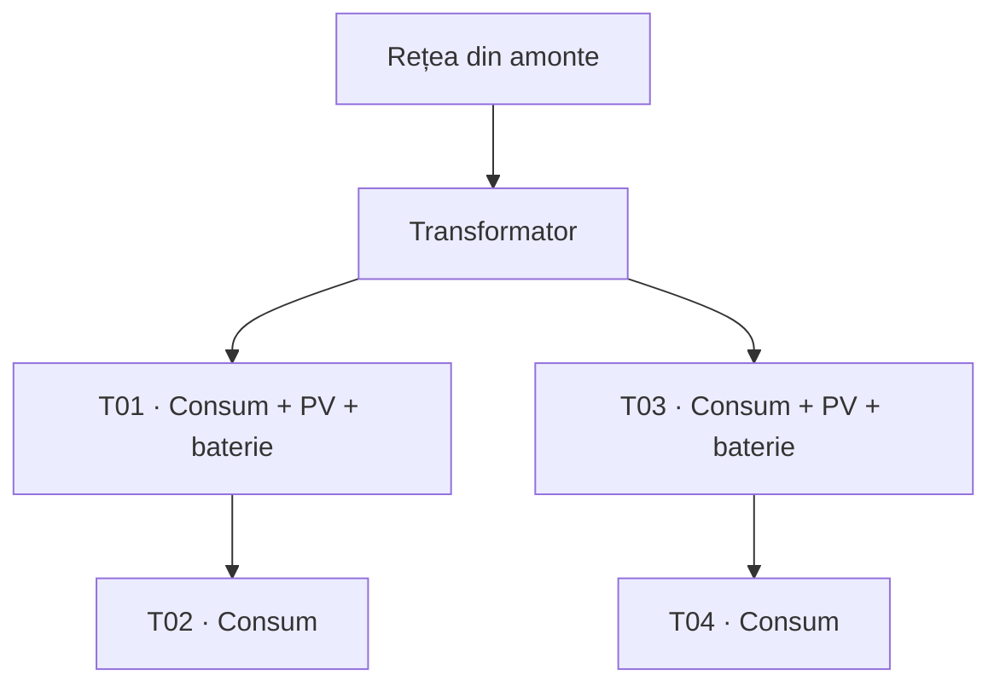
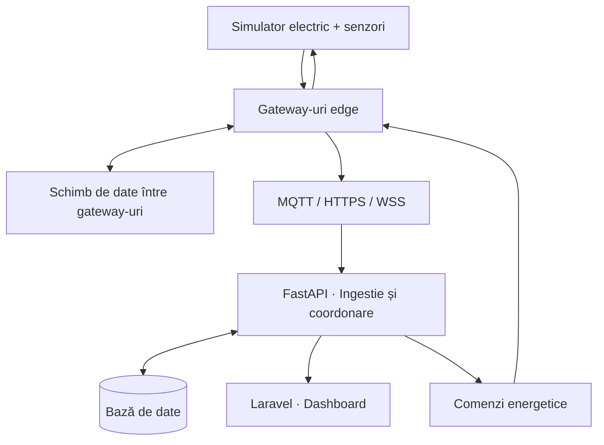

# Electrical Distribution IoT

**Platformă pentru monitorizarea și coordonarea energetică a unei rețele urbane de distribuție simulate.**

Electrical Distribution IoT integrează un simulator electric, senzori software, gateway-uri edge, comunicație multiprotocol și o interfață web pentru supravegherea unui sector de distribuție. Platforma urmărește consumul, producția fotovoltaică și energia stocată, validează telemetria și evaluează comenzi de încărcare sau descărcare a bateriilor în limitele rețelei.

Proiectul se concentrează pe **detecția locală a anomaliilor**, **reconectarea adaptivă** și **coordonarea resurselor energetice**. Eficiența acestor mecanisme urmează să fie verificată experimental.

> **Stadiu:** proiectare și documentare tehnică. Repository-ul nu conține încă o implementare executabilă; funcționalitățile descrise reprezintă arhitectura planificată.

## Modelul rețelei

Scenariul inițial include patru tablouri (`T01`–`T04`) conectate într-o rețea radială, alimentată dintr-o sursă echivalentă printr-un transformator. Tablourile `T01` și `T03` au asociate panouri fotovoltaice și baterii.

Configurația de pornire folosește o rețea de **0,4 kV**, un transformator **20/0,4 kV de 400 kVA**, consumuri de **10–60 kW per tablou**, surse PV de până la **80 kW** și baterii de **100 kWh / 30 kW**, cu limite de încărcare de **20–90% SoC**. Aceste valori sunt ipoteze de simulare, nu recomandări pentru instalații reale.

## Arhitectură și funcționalități

- **Simulatorul** generează profiluri reproductibile de consum și producție, calculează fluxurile de putere cu `pandapower` și introduce controlat erori, întârzieri sau lipsuri în măsurători.
- **Gateway-urile edge** verifică formatul, unitățile, ordinea temporală și plauzibilitatea datelor. Valorile brute și corecțiile sunt păstrate pentru trasabilitate; valorile critice reale sunt semnalate, nu normalizate artificial. Detectarea anomaliilor poate continua local când centrul este inaccesibil.
- **Comunicația multiprotocol** utilizează MQTT, HTTPS sau WebSocket securizat (WSS), în funcție de serviciile accesibile. Mesajele sunt identificate, confirmate și deduplicate; cele neconfirmate pot fi retransmise după reconectare.
- **Backend-ul central** colectează telemetria, corelează alertele și verifică comenzile energetice. Fiecare comandă are identificator, termen de valabilitate și stare de execuție, pentru a evita aplicarea duplicatelor sau a comenzilor expirate.
- **Interfața web** afișează topologia, consumul, producția, starea bateriilor, alertele și protocoalele active. Măsurătorile învechite sunt evidențiate explicit.

### Reconectare adaptivă

Un manager de conexiune monitorizează disponibilitatea serviciilor, latența și confirmările de livrare. Când legătura activă cade, selectează dintre protocoalele compatibile și accesibile alternativa cu cel mai mic cost estimat:

\[
C(p)=w_L\hat L_p+w_E\hat E_p+w_B\hat B_p,\qquad w_L+w_E+w_B=1
\]

Costul combină latența, rata eșecurilor și traficul per mesaj util. Pragurile de stabilitate limitează comutările repetate. Schimbarea protocolului nu poate remedia oprirea gateway-ului sau pierderea tuturor căilor de rețea.

### Coordonare energetică

Centrul analizează date recente și valide și generează comenzi candidate pentru baterii. Fiecare comandă este verificată printr-un calcul de flux de putere: tensiunile, curenții, încărcarea transformatorului și limitele bateriilor trebuie respectate. Dintre comenzile fezabile sunt preferate cele care reduc pierderile, fără a compromite alimentarea consumatorilor.

Starea bateriilor este actualizată la fiecare pas în funcție de putere, durată și randamente. Dacă nu există o comandă fezabilă, sistemul raportează situația în loc să forțeze un plan invalid. Distanța electrică poate ghida selecția resurselor, dar nu garantează pierderi minime.

## Tehnologii

| Componentă | Tehnologii prevăzute |
| --- | --- |
| Simulare și gateway-uri | Python, `asyncio` |
| Calcul electric | `pandapower` |
| Comunicații | MQTT, HTTPS, WSS |
| API și coordonare | FastAPI |
| Dashboard | Laravel 12, PHP, Blade, JavaScript |
| Persistență | PostgreSQL (în evaluare) |

## Evaluare experimentală

Experimentele sunt proiectate pentru a compara metodele în condiții reproductibile, cu aceleași profiluri, anomalii și seed-uri.

| Comparație | Indicatori urmăriți |
| --- | --- |
| Detecție centralizată vs. edge | F1, alarme false, latența detecției, trafic către centru |
| Protocol fix vs. selecție adaptivă | Timp de reconectare, rată de livrare, duplicate, număr de comutări |
| Proximitate vs. evaluare electrică a comenzilor | Pierderi de energie, încălcări de limite, energie servită, SoC final |

Scenariile includ funcționare normală, suprasarcină, erori de senzori, surplus fotovoltaic, căderea brokerului MQTT și indisponibilitatea tuturor comunicațiilor. Rezultatele vor fi raportate separat pentru detectarea locală, afișarea în dashboard și efectele comenzilor asupra rețelei. **Nu sunt prezentate încă rezultate experimentale validate.**

## Limitări

Modelul electric este trifazat echilibrat și nu reprezintă protecții reale, tranzitorii rapide sau dezechilibre între faze. Simularea nu comandă infrastructură electrică fizică, iar avantajele strategiilor analizate nu sunt presupuse înainte de măsurători. Reconectarea adaptivă necesită cel puțin o cale de comunicație funcțională.

## Referințe

- [pandapower — Power Flow](https://pandapower.readthedocs.io/en/latest/powerflow.html)
- [OASIS — MQTT 5.0](https://docs.oasis-open.org/mqtt/mqtt/v5.0/mqtt-v5.0.html)
- [FastAPI](https://fastapi.tiangolo.com/)
- [Laravel 12 — Blade](https://laravel.com/docs/12.x/blade)

Pentru prezentarea extinsă, vezi [documentul proiectului](Propunere_de_proiect__Electrical_Distribution_IoT_.pdf).

## Autori

Studenții **Hosu Răzvan** și **Nistor Dorin**.
